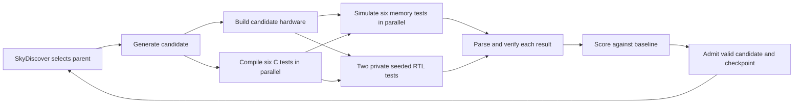

# DMA discovery with CHIA and SkyDiscover

This tutorial co-designs a DMA accelerator and six baremetal C workloads,
with edits permitted throughout the candidate codebase and each workload’s
output verified independently for runtime-varying inputs. CHIA deploys the workers and runs/caches
builds and simulations;
SkyDiscover's `DiscoveryController` owns the search through `openevolve_native`.



Read `run_experiment()` and `run_search()` in [loop.py](loop.py) first.
The native controller calls `CLIClient.generate()` in [search.py](chia_dma/search.py),
then `DMAEvaluator.evaluate()` in [evaluation.py](chia_dma/evaluation.py). The
evaluator shows the CHIA build, benchmark fan-out, parsing, scoring, and SQL save
in order. `experiment.py` uses `save_selection`, `save_proposal`,
`save_evaluation`, and `save_checkpoint` for the corresponding durable steps.
These files show the flow; [experiment.py](chia_dma/experiment.py) holds SQL history
and checkpoint recovery, while [source.py](chia_dma/source.py) preserves source
and candidate patches without importing SkyDiscover on workers.

Edit [cluster.yaml](cluster.yaml) for native CHIA placement, containers, and four
participant-facing knobs: `tutorial.agent.model`, `tutorial.agent.effort`,
`tutorial.search.iterations`, and `tutorial.search.max_in_flight`. Retry policy,
build policy, and fixed search settings live in [defaults.py](chia_dma/defaults.py);
dependency pins are in `load-env.sh`. The tutorial uses Antigravity and the login
created by `setup.md`. Pass `cluster.yaml` directly to `chia up/down`; jobs
upload the loop code with `--working-dir .`.

**Checkpoint selection is a CLI option, not a YAML setting.** `resume --run NAME`
loads the run's latest checkpoint. To continue from an older checkpoint, use
`fork --checkpoint NAME --new-run OTHER`, then resume the new run. A fork restores
full historical search state, including the population and islands.

The current machine runs the Ray head, search controller, SQLite, and cache.
Generation, hardware compilation, RISC-V compilation, and verification run in separate Docker/Ray workers on
`chia-dev`. Simulations run across `chia-worker-1` through `chia-worker-5`. Run commands on
the host, from the directory containing **`loop.py` and `cluster.yaml`**, after
`source load-env.sh`. From the repository root, first `cd discovery`.
The discovery folder supports both new runs and checkpoint restores.
Replace example run, candidate, checkpoint, and destination names with your own.

The original design instructions and reference image are preserved in
[loop_context/](loop_context/). These are historical context; use this README
and [INTEGRATION.md](INTEGRATION.md) for the current implementation.

## Set up and run

This section creates a new experiment without a host Chipyard checkout. For an
existing checkpoint, see [restore the tutorial archive](#restore-the-tutorial-archive).

Complete [setup.md](../setup.md) first, then work on `chia-dev`. That setup
creates the head and five worker VMs, installs Docker/SSH, authenticates
Antigravity, exports `CHIA_HEAD`, and installs `~/.ssh/chia-key` for access to the
existing workers. This loop only starts containers and Ray on those machines;
it never provisions GCP instances. `chia down` stops the tutorial containers and
Ray processes; VM lifecycle remains with the setup script.

`cluster.yaml` uses `$USER`, `$CHIA_HEAD`, and `~/.ssh/chia-key` from that setup.
Workers 1–2 are in us-west4 and workers 3–5 are in europe-west4. The plain worker
names are passed directly to native CHIA/SSH, as in the gem5 tutorial. SSH/DNS
and internal VPC connectivity must work between them. If you changed `WORKER_REGIONS`
during setup, update simulation `compatible_ips` and `num_workers` to match the
existing hosts.
No shared filesystem is required: `chia job submit --working-dir .` uploads the
loop code to every worker, and Ray carries simulator/ELF bytes and DRAM settings.
`experiments/` (via `.gitignore`) and the hidden correctness tests in `private/`
(via `.rayignore`) are never uploaded; only the verification container mounts
`private/`. The seed, agent credentials, SQL, and history stay on `chia-dev`.

Load the environment in each new terminal. It activates the `chia_env` that
`setup_gcp.sh` created (CHIA is already installed there) and adds SkyDiscover
and its dependencies on the head. Workers use CHIA from their published images
and never need SkyDiscover:

```sh
source load-env.sh
```

The commands below run **on the host**, with that environment activated. Native
CHIA commands manage workers and jobs. The tutorial's
`loop.py` handles source preparation and search-specific checkpoint operations;
these are not upstream CHIA subcommands.

The base implementation is [base/chipyard.patch](base/chipyard.patch), applied to
the initialized Chipyard source in the published CHIA build image. It contains
the DMA hardware, passive observer, and DMA/HTIF runtime. Preparation also copies
[base/memory-tests/](base/memory-tests/) into the immutable seed. See
[base/README.md](base/README.md) for source revisions and baseline updates.
No Chipyard submodule initialization or `build-setup.sh` is needed.

The host head uses Python 3.10.19 and Ray 2.54.0, matching the workers exactly;
Ray rejects even a Python patch-version mismatch. Native YAML activates
`chia_env` on the head and supplies worker import paths. Build tools come from the build image's own
Chipyard environment; the host environment is never mounted into workers.

Set `tutorial.agent.model` and `tutorial.agent.effort` in `cluster.yaml`. A null
model uses the authenticated Antigravity default; effort defaults to `medium`.
`tutorial.search.iterations` is the **total** number of search proposals across all
resumes (20 means 20 proposals total), excluding the seed evaluation.
To extend a run, increase that total. `tutorial.search.max_in_flight` bounds concurrent
candidate iterations (2 means up to 2 candidates progressing at once);
generation `num_workers` sets the number of generation containers, each with its
own writable `/home/ray/workspace` checkout initialized from the read-only seed.
Hardware builds, software builds, and simulations have independent limits.
Hardware compilation uses the head CPU count; software has six parallel build
slots. Each simulation worker advertises 32 simulation slots, matching the setup
VMs, and starts Ray with its local CPU count. Ray assigns the
six simulations across the five workers; candidates can overlap up to the search
limit. The JVM heap is fixed at 32 GiB.

```sh
RUN=run-001
RUN_DIR="$PWD/experiments/$RUN"
CLUSTER="$PWD/cluster.yaml"
JOB="$RUN-$(date +%s)"
set -o pipefail

python loop.py prepare --run "$RUN"
chia up "$CLUSTER" -y 2>&1 | tee -a "$RUN_DIR/cluster-up.log"
chia job submit --chia-cluster "$CLUSTER" --submission-id "$JOB" --no-wait --working-dir . -- \
  python -u "$PWD/loop.py" run --run "$RUN"
chia job logs --chia-cluster "$CLUSTER" "$JOB" --follow
```

When upgrading from a generated deployment, stop the old job and tear down its
cluster using the original `experiments/RUN/deployment/cluster.yaml` before
starting the static cluster.

`prepare` launches the CHIA build image, applies the bundled patch, and
preserves a complete read-only source seed, including Git and submodule metadata. Its identity includes the image and
patch, preparation-script, and C test hashes. Repeated preparation reuses that seed; checkpoint restores
use the run's recorded seed. The first task on each build and generation worker
creates a private checkout inside its container from the preserved repositories,
then reuses them with Git reset/clean before applying each patch. Generation
checkouts are transient: patches and transcripts are saved to SQL before a
generation task returns, and a replacement container reconstructs its checkout
from the seed and selected parent patch. The original development
checkout is never read or modified. `chia up` pulls the worker images.
The absolute entrypoint uses the head's local checkout; `--working-dir .` gives
workers the same loop code. `--chia-cluster` selects the job server.

Antigravity comes from its CHIA image. Each agent container copies the `setup.md`
login from `~/.gemini` at startup, so agent sessions never write to the host copy.
After re-authenticating on the host, restart the cluster to pick up the new login.

## Stop and resume

Pressing **Ctrl-C while following logs only stops the log viewer**; the submitted
job continues. In an activated host terminal, stop that job, then tear down its workers
and Ray head:

```sh
chia job stop "$JOB" --chia-cluster "$CLUSTER"
chia job logs --chia-cluster "$CLUSTER" "$JOB" > "$RUN_DIR/$JOB.log"
chia down "$CLUSTER" -y
```

Use `chia job list --chia-cluster "$CLUSTER"` to recover a job ID from another
terminal. Wait for the stop command to finish before teardown. Saving its logs
retains them after the job server stops.

Tear down with the same `cluster.yaml` that started the workers; do not change its
ports or hosts first. A completed driver also leaves workers running until
`chia down`. Teardown retains experiment files, SQL history, checkpoints, and the
preserved seed.

To continue the latest state later, run `source load-env.sh` on the host and set
`RUN`, `RUN_DIR`, and `CLUSTER` as above. Each submission needs a new
job ID; the experiment run name stays the same:

```sh
python loop.py prepare --run "$RUN"
chia up "$CLUSTER" -y
JOB="$RUN-$(date +%s)"
chia job submit --chia-cluster "$CLUSTER" --submission-id "$JOB" --no-wait --working-dir . -- \
  python -u "$PWD/loop.py" resume --run "$RUN"
chia job logs --chia-cluster "$CLUSTER" "$JOB" --follow
```

If the cluster is still up with the same configuration, just submit the resume
job. `chia down` stops this cluster's native head and container workers;
the checkout, Python environment, and experiment state remain available.

There is no explicit save command or checkpoint YAML field: checkpoints commit
automatically after seed initialization and controller callbacks. After an
interruption, the latest native checkpoint and SQL completions recover pending
work. Completed SQL proposals do not invoke the generation LLM again; unfinished
generations can. Build/simulation reuse depends on CHIA cache contents; evicted
or unfinished tasks may run again.

Resume reuses the saved Git seed, proposals, scores, and population with the
current settings. Code edits, comments, CPU counts, worker setup, and search
settings do not need to match a stored fingerprint. Old `frozen_hash` fields are
ignored. Saved data must still use the Git-patch proposal format; there is no
migration from the earlier source-map format.

Model and effort can change between resumes. Stop the current driver before
editing those knobs; submit a new resume job afterwards. Saved proposals retain
their recorded model and Git patch.

## Find a candidate or checkpoint

These commands are read-only and work while the driver runs:

```sh
python loop.py status --run "$RUN"        # latest checkpoint's recovery envelope
cat "$RUN_DIR/latest.json"               # checkpoint directory name
ls "$RUN_DIR/checkpoints"                # increasing checkpoint sequence
```

`status` shows checkpointed admitted candidate IDs and generated/evaluated flags;
SQL shows newer work that may not have reached a checkpoint yet. To list committed
checkpoints and their admitted candidates without loading the search engine:

```sh
python - "$RUN_DIR" <<'PY_CHECKPOINTS'
import json, pathlib, sys
run = pathlib.Path(sys.argv[1])
latest = json.loads((run / "latest.json").read_text())["checkpoint"]
for path in sorted((run / "checkpoints").glob("[!.]*/state.json")):
    state = json.loads(path.read_text())
    print(path.parent.name, "(latest)" if path.parent.name == latest else "")
    print("  admitted:", ", ".join(state["admitted"]))
PY_CHECKPOINTS
```

Choose an exact snapshot, or let `--candidate` find the earliest committed
checkpoint containing an admitted candidate:

```sh
CHECKPOINT=00000003-xxxxxxxx
python loop.py fork --run "$RUN" --checkpoint "$CHECKPOINT" --new-run branch-001
# Alternative: run this instead of the command above.
CANDIDATE=candidate-xxxxxxxx
python loop.py fork --run "$RUN" --candidate "$CANDIDATE" --new-run branch-001
```

Omit both selectors to fork the latest checkpoint. The destination must not
exist. Checkpoint names are directory basenames, not paths. A candidate must
already appear in a committed admission set. A concurrent snapshot can contain
other candidates too: the fork restores the entire snapshot, not just that
candidate, and subsequent parents are selected by native SkyDiscover sampling.

Forking works while the source driver is running: it reads immutable checkpoints
and takes an online SQLite backup, then removes history later than the selected
snapshot. The source run continues independently.

Every fork records the build image's registry
digest, baseline file hashes, and baseline Git revisions in `run.json`, so the
attendee can reconstruct the source seed without receiving its large source tree
and Git histories. The saved population and SQL history are unchanged.

`fork` creates the restored branch on disk; it does not start a cluster or
resume the search. A repeated fork to the same destination raises
`FileExistsError`; continue with the existing branch. Use its run name with the
`prepare`, `chia up`, and `resume` commands below. Attendees using the supplied
archive can skip checkpoint selection and forking entirely.

## Restore the tutorial archive

Distribute a portable fork with compatible tutorial code and the original
`base/` files. The archive contains SQL history, candidate patches, a native
population checkpoint, and a small seed rebuild recipe. It omits Chipyard source,
Git histories, task caches, and other cached seeds. CPU-affinity counts may differ
when restoring it. See [run.md](run.md) for the minimal runbook.

From the directory containing `loop.py`, select a candidate from `RUN` and package
its fork. The destination must not already exist:

```sh
RUN=run-001
python loop.py fork --run "$RUN" --candidate "$CANDIDATE" --new-run tutorial
tar -czf loop-tutorial.tar.gz experiments/tutorial
```

Attendees complete the setup under [Set up and run](#set-up-and-run), then work
inside the cloned repository's `discovery/` directory and extract into a checkout
without an existing `experiments/tutorial` run:

```sh
tar -xzf loop-tutorial.tar.gz
source load-env.sh

RUN=tutorial
RUN_DIR="$PWD/experiments/$RUN"
CLUSTER="$PWD/cluster.yaml"
python loop.py status --run "$RUN"
python loop.py prepare --run "$RUN"
chia up "$CLUSTER" -y
JOB="$RUN-$(date +%s)"
chia job submit --chia-cluster "$CLUSTER" --submission-id "$JOB" --no-wait --working-dir . -- \
  python -u "$PWD/loop.py" resume --run "$RUN"
chia job logs --chia-cluster "$CLUSTER" "$JOB" --follow
```

`status` shows the saved checkpoint's admitted candidates and pending-work flags.
`prepare` reconstructs a missing seed from the recipe's recorded image digest
and the original `base/` files, verifies its Git revisions, and caches it under
`experiments/seeds/`. Subsequent preparation reuses that seed. The first restore
requires access to the recorded Docker image and can take time. Existing full-seed
archives still work. `chia up` must finish before submitting the
resume job, which loads the saved population and recovers unfinished SQL work.
Completed proposals are retained; unfinished evaluations may run again.

The same run name and default ports work on each attendee's separate machine.
One cluster per user runs on a machine; the cluster is not tied to a run name,
so runs and forks using the same baseline can reuse it. Switching to a run with
a different baseline requires `chia down` and `chia up` to recreate worker checkouts.
See [INTEGRATION.md](INTEGRATION.md#restore-contract-and-compatibility) for the
saved-state contract.

## Logs and consolidated metrics

Set `RUN_DIR`, `CLUSTER`, and `JOB` to the experiment/submission you want to
inspect. CHIA exposes driver logs through its job commands while the head is
running; teardown saves them as `$RUN_DIR/$JOB.log`. Build/simulation logs appear
as tasks finish, not as live streams:

```sh
chia job list --chia-cluster "$CLUSTER"
chia job status --chia-cluster "$CLUSTER" "$JOB"
chia job logs --chia-cluster "$CLUSTER" "$JOB" --follow
ls "$RUN_DIR/artifacts"
CANDIDATE=candidate-xxxxxxxx
cat "$RUN_DIR/artifacts/$CANDIDATE/candidate.patch"
tail -n 80 "$RUN_DIR/artifacts/$CANDIDATE/hardware-build.log"
tail -n 80 "$RUN_DIR/artifacts/$CANDIDATE/wikisort.log"
tail -n 80 "$RUN_DIR/artifacts/$CANDIDATE/"*-build.log
chia status --chia-cluster "$CLUSTER"
```

At job exit, two native CHIA profile logs are saved in
`$RUN_DIR/artifacts/profile/`. `prof_full.log` keeps the task dependency graph
and the best validated geomean speedup so far. `prof_candidates.log` contains
every completed candidate evaluation, including the baseline, plus failed
generation attempts. Failed attempts score `0`; cached evaluation reads do not
add another sample.

```sh
PROFILE="$RUN_DIR/artifacts/profile"
chia viz-profile "$PROFILE/prof_full.log" --format html
chia viz-profile "$PROFILE/prof_full.log" --format svg
chia viz-profile "$PROFILE/prof_candidates.log" --format html
# CSV timing summary, with one row per function.
chia viz-profile "$PROFILE/prof_full.log" --format table --output "$PROFILE/timings.csv"
# Optionally restrict the summary to expensive task functions.
chia viz-profile "$PROFILE/prof_full.log" --format table --funcs build,build_program,simulate
```

In HTML, hover over or select a `score_point` to see `combined_score` and
`candidate_id`. In the full log these identify the best candidate; `evaluation_id`
identifies the attempt that triggered the update. An `evaluate` span also shows
its own score and `best_combined_score`. The candidate timeline shows each
attempt's score. The SVG output shows task dependencies.
The untouched `ChiaProfileCollector.log` retains all native task events and both
score series. Profile logs append across resumes of the same run.

Logging uses native `ChiaFunction` spans and `get_profiler().add_info`; CHIA is
unpatched. `--format table` writes CSV containing function name, call count,
mean, sample standard deviation, minimum, maximum, and total execution time in
seconds. It summarizes completed calls by function rather than listing candidate
scores. Summed execution times can exceed elapsed round time because tasks run
in parallel, and enclosing local spans include their child tasks.

For a separate XY score chart, use the discovery viewer from `discovery/`:

```sh
python loop.py scores --run DMADiscovery
```

Open `experiments/DMADiscovery/artifacts/profile/scores.html`. Time is on X and
score is on Y. Each candidate appears once, with its last 6 ID characters next
to its dot; hover or select the dot for its full ID, score, and completion time.
The best valid score is a separate number above the chart, including any best
inherited from a checkpoint. Failed attempts remain visible as pink dots.

This viewer lives entirely in `discovery/` and reads the existing native
`ChiaProfileCollector.log`; CHIA's `viz-profile` commands continue to provide
the task timelines. The command works while discovery runs and writes a snapshot:
rerun it and reload the page for newer completed evaluations. Pulling the viewer
changes requires no job restart, worker restart, or checkpoint restore. A fork's
profile starts with evaluations performed after the fork.

The configured Ray dashboard is at `http://127.0.0.1:8287`. Worker Ray logs are under `/tmp/ray/session_latest/logs` **inside each
container**; use `docker ps` to find its name (`dma-ROLE`), then `docker exec` to
inspect those files. Head Ray logs are on the host under
`/tmp/ray/dma/session_latest/logs`.
`cluster-up.log` captures native deployment output when started with the command
above. Generation response/transcript data lives in SQL, not a separate log file.

`metrics.db` is the consolidated numerical and lineage store. This read-only
query lists all proposals, their stage, score, patch hash, and parent/island:

```sh
python - "$RUN_DIR" <<'PY_METRICS'
import pathlib, sqlite3, sys
path = (pathlib.Path(sys.argv[1]) / "metrics.db").resolve()
with sqlite3.connect(path.as_uri() + "?mode=ro", uri=True) as db:
    rows = db.execute("""
        SELECT id, parent, island, kind, backend,
          CASE WHEN patch IS NULL THEN 'generation pending'
               WHEN metrics IS NULL THEN 'evaluation pending'
               WHEN json_extract(metrics, '$.validity') = 0 THEN 'rejected'
               ELSE 'valid; see checkpoint for admission' END AS stage,
          round(json_extract(metrics, '$.combined_score'), 5) AS score,
          patch_hash
        FROM proposals ORDER BY sequence
    """)
    print("\t".join(column[0] for column in rows.description))
    for row in rows:
        print("\t".join("-" if value is None else str(value) for value in row))
PY_METRICS
```

A score above `1` means faster than the seed on scored workloads; validity must
be `1`. Admission is confirmed by the checkpoint's `admitted` set. To inspect
per-benchmark cycles/speedups and the generation response for one proposal:

```sh
CANDIDATE=candidate-xxxxxxxx
python - "$RUN_DIR" "$CANDIDATE" <<'PY_CANDIDATE'
import pathlib, sqlite3, sys
path = (pathlib.Path(sys.argv[1]) / "metrics.db").resolve()
with sqlite3.connect(path.as_uri() + "?mode=ro", uri=True) as db:
    for row in db.execute("""
        SELECT name, json_extract(metrics, '$.benchmark_cycles'),
          json_extract(metrics, '$.speedup'),
          json_extract(metrics, '$.region_offloaded'),
          json_extract(metrics, '$.region_bytes')
        FROM benchmarks WHERE candidate=? AND name!='error'
        ORDER BY name
    """, (sys.argv[2],)):
        print(row)  # workload, timed cycles, speedup, timed offloads, timed bytes
    error = db.execute("SELECT metrics FROM benchmarks WHERE candidate=? AND name='error'",
                       (sys.argv[2],)).fetchone()
    if error:
        print("rejection:", error[0])
    response = db.execute("SELECT json_extract(generation, '$.response') FROM proposals WHERE id=?",
                          (sys.argv[2],)).fetchone()
    if response:
        print("generation response:", response[0])
PY_CANDIDATE
```

Use `$.transcript` instead of `$.response` for the saved agent transcript. The
first successful evaluation provides the fitness reference; there is no `reference.json`.
Live read-only queries are safe. To copy a live database, use `fork` or SQLite's
backup API rather than copying `metrics.db` alone while its WAL is active.

## Evaluation and validation

Each generation resets its entire writable checkout to the selected parent.
There is no edit allowlist: additions, deletions, renames, executable files,
binaries, and SoC/build-file changes are recorded as changes relative to the
immutable seed. Restoring the parent clears files left by the previous generation.
BashTool runs in that generation container. Seeds are mounted read-only; hidden
correctness code is mounted only into verification, and SQL/history and other
candidate workspaces are not mounted there. Native CHIA uses trusted agents on a shared host network; this
filesystem separation is not a sandbox for hostile native code or Ray clients.

The hardware build and six `RiscvBuildNode.build_program` calls are submitted
together. Software builds use the dedicated `riscv_build: 6` worker and independent
task directories, so they can run concurrently with each other and the hardware
build. Native CHIA returns the ELF files as bytes; no candidate shares a software
build directory. Each candidate follows these explicit CHIA nodes:

| Node | Inputs | Output |
| --- | --- | --- |
| `build` | Configuration, immutable Git seed, candidate patch | Simulator artifact |
| `RiscvBuildNode.build_program` (one per test) | C sources/helpers, preserved evaluation harness, build command | ELF bytes and compiler output |
| `simulate` (one per test) | Configuration, simulator artifact, ELF bytes, test name, DRAM settings | Captured run result |
| `parse` (one per result) | Successful run result with cycle measurements | Software measurements |
| `run_hidden_tests` | Candidate binaries, simulator, fresh private seeds | Private verdict and anonymous wall times; launches two worker simulations |
| `verify_correctness` | Scored observations, public seeds, private verdict | Boolean correctness gate |
| `aggregate` | Measurements, seed results, workload specifications, candidate patch | Fitness and per-test metrics |

The flow lives in `chia_dma/evaluation.py`; worker task bodies live in
`chia_dma/nodes.py`. Parsing
and scoring use their supplied data and do not read an experiment or load code
from a seed. The existing controller adapter collects results and persists them
through CHIA SQLite; it does not implement another task scheduler.

The parser accepts extra diagnostic fields and metric-version changes; missing
instruction counts are recorded as zero. The private SHA-256 gate verifies the
complete output of all six tests. If the initial baseline fails, search continues
from its zero-score seed so the agent can propose a repair. The first successful
evaluation becomes the performance reference; missing reference rows contribute
a neutral 1x speedup. Build or simulation errors reject that proposal, and
unfinished requests remain available for resume.

Each proposal is one ordinary Git patch against the prepared seed commits.
Git stages edits and new files, then emits a binary-capable diff for the root
repository and each initialized submodule. Submodule paths are included in the
same patch. Candidate restoration resets and cleans the existing checkouts to the seed commits,
then applies one `git apply`. Git preserves
file contents, additions, deletions, symlinks, and executable bits. SQL stores the
patch text directly; `artifacts/CANDIDATE/candidate.patch` is a readable copy.
The original image's Git history remains in the preserved seed. Preparation
records the tutorial additions as baseline commits without changing the image.

The six workloads and their callable interfaces remain the optimization target.
The compiler receives candidate C code/helpers and the preserved checksum readers,
output storage, support code, Makefile, and DMA/HTIF measurement runtime. Changes
to workspace copies of evaluator inputs do not change the harness.

The verification node chooses fresh runtime seeds **after compilation** and
patches the ELF input record. The six timed runs fan out across the five worker
VMs. SHA-256 digests covering the complete output buffers, guard regions, and
chain witness are compared with hashes of independently generated reference
outputs. After timing stops, HTIF transfers the raw buffer to the simulation worker;
the worker hashes those original bytes with Python `hashlib`, then deletes
the temporary transfer files. No cryptographic hashing runs on the simulated CPU.
The same binaries and harness also run two unscored correctness cases with
different private seeds. The verification node dispatches these onto the existing
simulation workers alongside the public runs, then checks their outputs privately.
There is no additional Spike build or candidate-code reference oracle.

Scored and private runs use the same observation mode and fresh nonzero seeds,
so a candidate cannot distinguish them using a public seed-zero or validation-mode
branch. Buffer reporting occurs after the timed interval. The original seed-zero
checksums remain available for the standalone native baseline audit.

The hidden correctness module and reference implementation are excluded from the
uploaded code and mounted only into verification. Private seeds and observations stay on the verification
node, except for the binaries sent to the execution workers. Only pass/fail and
anonymous test runtimes return from private evaluation. Any correctness failure gives the
proposal zero fitness, prevents population admission, counts against the proposal
budget, and supplies generic failure feedback to the next attempt on that island.
No private test contents appear in that feedback. Native CHIA still uses a
trusted Ray cluster; these filesystem boundaries do not isolate a hostile Ray client.
Copy counts, transferred bytes, and DMA usage remain diagnostic rather than
acceptance requirements.

The iron law is `time = instructions × CPI / frequency`. At the modeled fixed
frequency, the objective is **total simulated cycles**, not IPC or DMA bandwidth.
Fitness is the equally weighted geometric mean of `seed cycles / candidate cycles` over
all six tests, including tests that use no DMA. Retired instructions and CPI are
reported per test and in total. MAP-Elites uses patch size and instruction count.
This evaluates fixed-clock performance; it does not estimate synthesis Fmax or
critical-path changes. See the [CS 61C performance equation](https://notes.cs61c.org/content/parallel-tlp/)
and [RISC-V cycle/instruction counters](https://docs.riscv.org/reference/isa/priv/machine.html).

Fixed-output precomputation and weak-checksum collisions are rejected by the
runtime-seeded full-buffer digest checks. The Python verifier uses
[`hashlib.sha256`](https://docs.python.org/3/library/hashlib.html#hashlib.sha256)
over independently generated expected buffers.

Each public and hidden RTL simulation uses CHIA's native **30-minute timeout**.
An expired simulation returns a failed result and the proposal fails its test.
Correctness checks determine validity, and simulated cycle counts determine
performance. CHIA runs the simulator directly; temporary output files are
removed after collection or interruption.
All eight tests are submitted in parallel across the existing simulation slots.
Per-round `artifacts/CANDIDATE/timing.json` records the public test times, anonymous
hidden test times, build time, generation time, evaluation time, and total round
wall time including queueing. `artifacts/exercise-timing.json` records the complete
command duration and completion status. There is no search-wide wall-clock
cutoff; search runs for the requested number of iterations. Defaults run two
optimization proposals concurrently after the baseline, with a 600-second agent
budget per proposal (no retries) and a 600-second hardware compilation budget.
See [LOCAL_TIMING.md](LOCAL_TIMING.md) for historical local timing measurements.
Hardware-only, Embench, and source-map checkpoints use different saved-data
formats and require their original implementations.

One writer is allowed per run. Completed evaluation records repair interruption
before population admission.
Native checkpoints do not save RNG state: already selected work retains its
parent/island context, while future stochastic choices can differ. Runs require
the current matching checkpoint format; there are no old-format migrations.

```sh
python -m pip install pytest==9.1.1
python -m pytest -c pytest.ini tests -q
CHIA_LIVE_AGENTS=1 python -m pytest -c pytest.ini tests/test_native_cluster.py -q
```

See [INTEGRATION.md](INTEGRATION.md) for ownership, checkpoint contents, restore
requirements, and validation evidence.

## File roles

| File | Role |
| --- | --- |
| `cluster.yaml` | Existing worker placement, containers, native cache settings, and four participant controls. |
| `base/chipyard.patch` | DMA hardware, observer, and HTIF runtime applied to the build image’s Chipyard source. |
| `base/prepare.sh` | Materialize the image, patch, and fixed memory-test sources inside Docker. |
| `base/memory-tests/` | Six C tests, expected checksums, Makefile, and native correctness checks. |
| `base/README.md` | Base source revisions and baseline update procedure. |
| `load-env.sh` | Activate `chia_env` and install SkyDiscover and its dependencies on the head. |
| `loop.py` | Experiment flow, seed evaluation, native controller setup, and CLI commands. |
| `LOCAL_TIMING.md` | Historical test and round runtimes and estimated exercise duration. |
| `chia_dma/config_loader.py` | Load YAML, resolve paths, set serial checkout slots, and identify new source seeds. |
| `chia_dma/defaults.py` | Fixed settings, source paths, and configuration declarations. |
| `chia_dma/observations.py` | Bulk observation transfer, host hashing, and temporary-file cleanup. |
| `private/correctness.py` | Hidden correctness tests: private runtime inputs, independent output reference, and correctness gate. Mounted only into the verification container. |
| `chia_dma/runtime.py` | Preserve the seed, attach CHIA cache/profiler. |
| `chia_dma/profiling.py` | Native score metadata and best/candidate views of the collected profile. |
| `chia_dma/score_viz.py` | Standalone XY candidate score chart and best-score readout from the native CHIA log. |
| `chia_dma/agent.py` | Initialize the selected parent, invoke a native CLI agent with BashTool, and save its proposal. |
| `chia_dma/search.py` | SkyDiscover adapters that hand selected parents to the agent (head only). |
| `chia_dma/evaluation.py` | Build → simulate → verify → score pipeline and task lifecycle. |
| `chia_dma/nodes.py` | Required build, simulation, measurement parsing, and equal-weight scoring tasks. |
| `archive/evaluation_extras.py` | Optional weighted scoring and DMA-event parsing, excluded from the tutorial runtime. |
| `chia_dma/experiment.py` | Head-only search state: SQL metrics, native population, checkpoints, forks, and the writer lock. |
| `chia_dma/source.py` | Git seed preservation, worker checkouts, patch capture/restoration, and saved proposals; imported by workers. |
| `chia_dma/__init__.py` | Python package marker. |
| `tests/test_contract.py` | Source, Antigravity, parser, and fitness contracts. |
| `tests/test_correctness.py` | Seeded reference validation and checksum-hack regressions. |
| `tests/test_timing.py` | Native simulation timeout, interruption cleanup, and elapsed-time reporting. |
| `tests/test_controller_integration.py` | Controller concurrency, cache/profiler, and recovery integration. |
| `tests/test_profiling.py` | Paired native score events across resumed jobs. |
| `tests/test_score_viz.py` | One labeled dot per proposal, best-score readout, live-log handling, and offline rendering. |
| `tests/test_native_cluster.py` | Live-container checks, currently skipped pending migration to static configuration and working-directory uploads. |
| `tests/native_fixture.py` | Temporary localhost SSH fixture for native cluster tests. |
| `tests/test_preservation.py` | Immutable seed reuse, candidate restoration, and archive relocation. |
| `tests/test_portable.py` | Small archive round trips, complete proposal history, seed reconstruction, and baseline mismatch detection. |
| `tests/test_cluster.py` | Existing host placement, native configuration routing, and simulation fan-out across all workers. |
| `tests/conftest.py` | Load test source inputs from the bundled patch. |
| `tests/fixtures/memory-observation.txt` | Recorded hardware plus synthetic software counters for parser integration. |
| `pytest.ini` | Test import paths. |
| `README.md` | Tutorial procedure and file map. |
| `INTEGRATION.md` | Infrastructure choices and validation evidence. |
