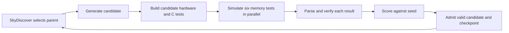

# DMA discovery with CHIA and SkyDiscover

This tutorial co-designs two DMA accelerator Scala files and six baremetal C
workloads, preserving each workload’s original checksum. CHIA deploys the workers and runs/caches
builds and simulations;
SkyDiscover's `DiscoveryController` owns the search through `openevolve_native`.



Read `run_experiment()` and `run_search()` in [loop.py](loop.py) first.
The native controller calls `CLIClient.generate()` in [agent.py](chia_dma/agent.py),
then `DMAEvaluator.evaluate()` in [evaluation.py](chia_dma/evaluation.py). The
evaluator shows the CHIA build, benchmark fan-out, parsing, scoring, and SQL save
in order. `experiment.py` uses `save_selection`, `save_proposal`,
`save_evaluation`, and `save_checkpoint` for the corresponding durable steps.
Those three files show the flow; [experiment.py](chia_dma/experiment.py) holds
source preservation, SQL history, and checkpoint recovery.

Edit [config.yaml](config.yaml) for native CHIA placement, resource/container
counts, container names/images, Ray connection, LLM provider, and proposal counts.
[backend.yaml](backend.yaml) specifies the fixed mounts, credentials, dependency
pins, isolation, and evaluation settings. `prepare` combines them into a native
`deployment/cluster.yaml`; pass that generated file to `chia up/down`.

**Checkpoint selection is a CLI option, not a YAML setting.** `resume --run NAME`
loads the run's latest checkpoint. To continue from an older checkpoint, use
`fork --checkpoint NAME --new-run OTHER`, then resume the new run. A fork restores
full historical search state, including the population and islands.

The current machine runs the Ray head, search controller, SQLite, and cache.
Generation, compilation, and simulation run in Docker workers. Run commands on
the host, from the directory containing **`loop.py` and `config.yaml`**, with
`.venv` activated. From the repository root, first `cd discovery`.
The discovery folder supports both new runs and checkpoint restores.
Replace example run, candidate, checkpoint, and destination names with your own.

The original design instructions and reference image are preserved in
[loop_context/](loop_context/). These are historical context; use this README
and [INTEGRATION.md](INTEGRATION.md) for the current implementation.

## Set up and run

This section creates a new experiment without a host Chipyard checkout. For an
existing checkpoint, see [restore the tutorial archive](#restore-the-tutorial-archive).

Use a Linux x86-64 host. The Ubuntu commands below install host utilities and
start SSH; install [Docker Engine](https://docs.docker.com/engine/install/ubuntu/)
if it is not already available. No host Chipyard, Java, sbt, Verilator, RISC-V
compiler, Conda environment, or agent CLI is needed.

```sh
sudo apt-get update
sudo apt-get install -y ca-certificates curl git openssh-server rsync
sudo systemctl enable --now ssh
```

Docker must work without sudo for your user and its SSH sessions. After installing
Docker, use its [group setup](https://docs.docker.com/engine/install/linux-postinstall/)
if needed:

```sh
sudo usermod -aG docker "$USER"
```

Log out and back in after changing groups, or run `newgrp docker` to open a shell
with Docker access, then reactivate `.venv` in that shell. The example is
single-host; all source/state bind paths must be available to that Docker daemon.

Native CHIA connects to this machine through SSH. If you have not configured
local key authentication, run this once; it retains an existing default key:

```sh
mkdir -p "$HOME/.ssh"
chmod 700 "$HOME/.ssh"
if [ ! -f "$HOME/.ssh/id_ed25519" ]; then
  ssh-keygen -q -t ed25519 -N '' -f "$HOME/.ssh/id_ed25519"
fi
cat "$HOME/.ssh/id_ed25519.pub" >> "$HOME/.ssh/authorized_keys"
chmod 600 "$HOME/.ssh/authorized_keys"
```

`config.yaml` defaults to this key and `$USER`. If an existing key needs a
passphrase, load it into your SSH agent before `chia up`. Authenticate your
selected LLM provider using its container CLI and retain its login files at the
credential paths in `backend.yaml`.

From the directory containing `loop.py`, create the host head's Python
environment once. Keep `base/` and both YAML files. Start without copied
`.venv/` or `.deps/` directories: their installed paths belong to the old location.
Git is needed to download dependencies, but your loop itself needs no Git metadata.

Install [uv](https://docs.astral.sh/uv/getting-started/installation/); it downloads
the exact Python interpreter, so no preinstalled Python is required. Bootstrap
installs pinned CHIA, SkyDiscover from evolve-flows, and the OpenEvolve dependencies.
It omits SkyDiscover's optional AlphaEvolve backend. Workers use published CHIA
images and install missing packages inside their own containers. No derived image
or head container is created:

```sh
curl -LsSf https://astral.sh/uv/install.sh | sh
export PATH="$HOME/.local/bin:$PATH"
uv venv --python 3.10.19 --managed-python --seed .venv
source .venv/bin/activate
python -m pip install pyyaml==6.0.3
python bootstrap.py
```

The commands below run **on the host**, with that environment activated. Native
CHIA commands manage workers and jobs. The tutorial's
`loop.py` handles source preparation and search-specific checkpoint operations;
these are not upstream CHIA subcommands.

The base implementation is [base/chipyard.patch](base/chipyard.patch), applied to
the initialized Chipyard source in the published CHIA build image. It contains
the DMA hardware, passive observer, and DMA/HTIF runtime. Preparation also copies
[base/memory-tests/](base/memory-tests/) into the immutable seed. See
[base/README.md](base/README.md) for source revisions and baseline updates.
No Chipyard submodule initialization or `build-setup.sh` is needed.

The host head uses Python 3.10.19 and Ray 2.54.0, matching the workers exactly;
Ray rejects even a Python patch-version mismatch. Native YAML activates the
`.venv` beside `loop.py` and
supplies worker import paths. Build tools come from the build image's own
Chipyard environment; the host environment is never mounted into workers.

Choose `agent.backend: antigravity`, `codex`, or `claude` in `config.yaml`.
`search.iterations` is the **total** number of search proposals across all
resumes (20 means 20 proposals total), excluding the seed and replay evaluations.
To extend a run, increase that total. `search.max_in_flight` bounds concurrent
candidate iterations (2 means up to 2 candidates progressing at once);
generation `num_workers` sets the number of isolated generation workspaces.
Build and simulation pools have independent limits. Compilation uses all CPUs
available to the host process, simulations fan out one task per available CPU,
and the JVM heap is fixed at 32 GiB.

```sh
RUN=run-001
RUN_DIR="$PWD/experiments/$RUN"
CLUSTER="$RUN_DIR/deployment/cluster.yaml"
JOB="$RUN-$(date +%s)"
set -o pipefail

python loop.py prepare --run "$RUN"
chia up "$CLUSTER" -y 2>&1 | tee -a "$RUN_DIR/cluster-up.log"
chia job submit --chia-cluster "$CLUSTER" --submission-id "$JOB" --no-wait -- \
  python -u "$PWD/loop.py" run --run "$RUN"
chia job logs --chia-cluster "$CLUSTER" "$JOB" --follow
```

`prepare` launches the pinned CHIA build image, applies the bundled patch, and
preserves a complete read-only source seed. Its identity includes the image and
patch, preparation-script, evaluator, and C test hashes. Repeated preparation reuses that seed; checkpoint restores
use the run's recorded seed. Native build workers copy it into a private checkout
for `ChiselBuildNode`; generation sees it read-only. The original development
checkout is never read or modified. `chia up` pulls the pinned worker images.
The absolute entrypoint uses the head's local checkout; omit `--working-dir` to
avoid uploading experiment artifacts. Head/worker imports come from native YAML.
`--chia-cluster` selects the correct job server from the rendered YAML, including
for a live fork.

Antigravity/Claude binaries come from their upstream images. Codex is installed
with pinned npm inside its generation container, using the upstream Claude
image's Node runtime. Provider logins are copied
from read-only mounts into a private worker home. Existing login files can be
reused. Refresh expired credential files through the provider's container CLI
and redeploy workers to refresh their private copies.

## Stop and resume

Pressing **Ctrl-C while following logs only stops the log viewer**; the submitted
job continues. In an activated host terminal, stop that job, then tear down its workers
and Ray head:

```sh
chia job stop "$JOB" --chia-cluster "$CLUSTER"
chia job logs --chia-cluster "$CLUSTER" "$JOB" > "$RUN_DIR/$JOB.log"
chia down "$CLUSTER" -y
```

Use `chia job list --chia-cluster "$CLUSTER"` to recover a job ID from another
terminal. Wait for the stop command to finish before teardown. Saving its logs
retains them after the job server stops.

Use the deployment YAML that actually started those workers. Keep it until
teardown; do not regenerate it with changed ports/providers first. A completed
driver also leaves workers running until `chia down`. Teardown retains experiment
files, SQL history, checkpoints, and the preserved seed. Other live runs should
use their own deployment YAML and distinct names/ports.

To continue the latest state later, activate `.venv` on the host and set
`RUN`, `RUN_DIR`, and `CLUSTER` as above. Each submission needs a new
job ID; the experiment run name stays the same:

```sh
python loop.py prepare --run "$RUN"
chia up "$CLUSTER" -y
JOB="$RUN-$(date +%s)"
chia job submit --chia-cluster "$CLUSTER" --submission-id "$JOB" --no-wait -- \
  python -u "$PWD/loop.py" resume --run "$RUN"
chia job logs --chia-cluster "$CLUSTER" "$JOB" --follow
```

If the cluster is still up with the same configuration, just submit the resume
job. `chia down` stops this cluster's native head and container workers;
the checkout, Python environment, and experiment state remain available.

There is no explicit save command or checkpoint YAML field: checkpoints commit
automatically after seed initialization and controller callbacks. After an
interruption, the latest native checkpoint and SQL completions recover pending
work. Completed SQL proposals do not invoke the generation LLM again; unfinished
generations can. Build/simulation reuse depends on CHIA cache contents; evicted
or unfinished tasks may run again.

The native-head worker setup and DMA-only baseline change the frozen contract. Earlier
experiments require their original matching loop code/settings; start a new run
for this setup. Existing experiment files are retained; no checkpoint migration
is provided.

To switch providers: stop the driver, use `chia down` on its existing deployment,
edit `agent.backend`, then `prepare`, `chia up`, and `resume`. Saved proposals
retain their original provider and sources.

## Find a candidate or checkpoint

These commands are read-only and work while the driver runs:

```sh
python loop.py status --run "$RUN"        # latest checkpoint's recovery envelope
cat "$RUN_DIR/latest.json"               # checkpoint directory name
ls "$RUN_DIR/checkpoints"                # increasing checkpoint sequence
```

`status` shows checkpointed admitted candidate IDs and generated/evaluated flags;
SQL shows newer work that may not have reached a checkpoint yet. To list committed
checkpoints and their admitted candidates without loading the search engine:

```sh
python - "$RUN_DIR" <<'PY_CHECKPOINTS'
import json, pathlib, sys
run = pathlib.Path(sys.argv[1])
latest = json.loads((run / "latest.json").read_text())["checkpoint"]
for path in sorted((run / "checkpoints").glob("[!.]*/state.json")):
    state = json.loads(path.read_text())
    print(path.parent.name, "(latest)" if path.parent.name == latest else "")
    print("  admitted:", ", ".join(state["admitted"]))
PY_CHECKPOINTS
```

Choose an exact snapshot, or let `--candidate` find the earliest committed
checkpoint containing an admitted candidate:

```sh
CHECKPOINT=00000003-xxxxxxxx
python loop.py fork --run "$RUN" --checkpoint "$CHECKPOINT" --new-run branch-001
# Alternative: run this instead of the command above.
CANDIDATE=candidate-xxxxxxxx
python loop.py fork --run "$RUN" --candidate "$CANDIDATE" --new-run branch-001
```

Omit both selectors to fork the latest checkpoint. The destination must not
exist. Checkpoint names are directory basenames, not paths. A candidate must
already appear in a committed admission set. A concurrent snapshot can contain
other candidates too: the fork restores the entire snapshot, not just that
candidate, and subsequent parents are selected by native SkyDiscover sampling.

Forking works while the source driver is running: it reads immutable checkpoints
and takes an online SQLite backup, then removes history later than the selected
snapshot. The source run continues independently.

`fork` creates the restored branch on disk; it does not start a cluster or
resume the search. A repeated fork to the same destination raises
`FileExistsError`; continue with the existing branch. Use its run name with the
`prepare`, `chia up`, and `resume` commands below. Attendees using the supplied
archive can skip checkpoint selection and forking entirely.

## Restore the tutorial archive

The archive contains the matching loop code, a stopped experiment, and its
complete seed. Tutorial machines use matching specs and CPU-affinity counts.

After [stopping the loop](#stop-and-resume), the instructor creates the archive
from the directory containing `loop.py`. Set `RUN` to the experiment to share:

```sh
RUN=run-001
tar -czf ../loop-tutorial.tar.gz \
  --exclude=__pycache__ --exclude=.writer.lock \
  --exclude=base/memory-tests/build \
  --exclude="experiments/$RUN/cache" --exclude="experiments/$RUN/artifacts" \
  --exclude="experiments/$RUN/deployment" --exclude="experiments/$RUN/work" \
  *.py *.yaml chia_dma base tests README.md INTEGRATION.md pytest.ini \
  "experiments/$RUN" experiments/seeds
```

This includes saved population/SQL hardware and C sources, preserves seed links
and permissions, and leaves installed environments and generated work out.

Attendees complete the Docker, SSH, provider login, and `uv` host setup under
[Set up and run](#set-up-and-run), then extract into a new folder and resume:

```sh
mkdir loop
tar -xzf loop-tutorial.tar.gz -C loop
cd loop
uv venv --python 3.10.19 --managed-python --seed .venv
source .venv/bin/activate
python -m pip install pyyaml==6.0.3
python bootstrap.py

RUN=run-001  # Use the run name packaged by the instructor.
RUN_DIR="$PWD/experiments/$RUN"
CLUSTER="$RUN_DIR/deployment/cluster.yaml"
python loop.py status --run "$RUN"
python loop.py prepare --run "$RUN"
chia up "$CLUSTER" -y
JOB="$RUN-$(date +%s)"
chia job submit --chia-cluster "$CLUSTER" --submission-id "$JOB" --no-wait -- \
  python -u "$PWD/loop.py" resume --run "$RUN"
chia job logs --chia-cluster "$CLUSTER" "$JOB" --follow
```

`status` shows the saved checkpoint's admitted candidates and pending-work flags.
`prepare` finds the bundled seed under `experiments/seeds/HASH/` and regenerates
paths for the extracted folder. `chia up` must finish before submitting the
resume job, which loads the saved population and recovers unfinished SQL work.
Completed proposals are retained; unfinished evaluations may run again.

The same run name and default ports work on each attendee's separate machine.
If switching runs on one machine, tear down the previous cluster with its
original deployment YAML first. Only simultaneous clusters on the same machine
need separate Ray/dashboard ports and matching head/worker connection settings.
See [INTEGRATION.md](INTEGRATION.md#restore-contract-and-compatibility) for the
saved-state contract.

## Logs and consolidated metrics

Set `RUN_DIR`, `CLUSTER`, and `JOB` to the experiment/submission you want to
inspect. CHIA exposes driver logs through its job commands while the head is
running; teardown saves them as `$RUN_DIR/$JOB.log`. Build/simulation logs appear
as tasks finish, not as live streams:

```sh
chia job list --chia-cluster "$CLUSTER"
chia job status --chia-cluster "$CLUSTER" "$JOB"
chia job logs --chia-cluster "$CLUSTER" "$JOB" --follow
ls "$RUN_DIR/artifacts"
CANDIDATE=candidate-xxxxxxxx
tail -n 80 "$RUN_DIR/artifacts/$CANDIDATE/build.log"
tail -n 80 "$RUN_DIR/artifacts/$CANDIDATE/wikisort.log"
tail -n 80 "$RUN_DIR/software-build.log"
chia status --chia-cluster "$CLUSTER"
# Task durations/cache callback profiling; emits a consolidated CSV table.
chia viz-profile "$RUN_DIR/artifacts/profile/ChiaProfileCollector.log" --format table
```

The configured Ray dashboard is at `http://127.0.0.1:8287` (branch example:
`8288`). Worker Ray logs are under `/tmp/ray/session_latest/logs` **inside each
container**; use `docker ps` to find its rendered name, then `docker exec` to
inspect those files. Head Ray logs are on the host under
`/tmp/ray/dma-$RUN/session_latest/logs`.
`cluster-up.log` captures native deployment output when started with the command
above. Generation response/transcript data lives in SQL, not a separate log file.

`metrics.db` is the consolidated numerical and lineage store. This read-only
query lists all proposals, their stage, score, source hash, and parent/island:

```sh
python - "$RUN_DIR" <<'PY_METRICS'
import pathlib, sqlite3, sys
path = (pathlib.Path(sys.argv[1]) / "metrics.db").resolve()
with sqlite3.connect(path.as_uri() + "?mode=ro", uri=True) as db:
    rows = db.execute("""
        SELECT id, parent, island, kind, backend,
          CASE WHEN source IS NULL THEN 'generation pending'
               WHEN metrics IS NULL THEN 'evaluation pending'
               WHEN json_extract(metrics, '$.validity') = 0 THEN 'rejected'
               ELSE 'valid; see checkpoint for admission' END AS stage,
          round(json_extract(metrics, '$.combined_score'), 5) AS score,
          source_hash
        FROM proposals ORDER BY sequence
    """)
    print("\t".join(column[0] for column in rows.description))
    for row in rows:
        print("\t".join("-" if value is None else str(value) for value in row))
PY_METRICS
```

A score above `1` means faster than the seed on scored workloads; validity must
be `1`. Admission is confirmed by the checkpoint's `admitted` set. To inspect
per-benchmark cycles/speedups and the generation response for one proposal:

```sh
CANDIDATE=candidate-xxxxxxxx
python - "$RUN_DIR" "$CANDIDATE" <<'PY_CANDIDATE'
import pathlib, sqlite3, sys
path = (pathlib.Path(sys.argv[1]) / "metrics.db").resolve()
with sqlite3.connect(path.as_uri() + "?mode=ro", uri=True) as db:
    for row in db.execute("""
        SELECT name, json_extract(metrics, '$.benchmark_cycles'),
          json_extract(metrics, '$.speedup'),
          json_extract(metrics, '$.region_offloaded'),
          json_extract(metrics, '$.region_bytes')
        FROM benchmarks WHERE candidate=? AND name!='error'
        ORDER BY name
    """, (sys.argv[2],)):
        print(row)  # workload, timed cycles, speedup, timed offloads, timed bytes
    error = db.execute("SELECT metrics FROM benchmarks WHERE candidate=? AND name='error'",
                       (sys.argv[2],)).fetchone()
    if error:
        print("rejection:", error[0])
    response = db.execute("SELECT json_extract(generation, '$.response') FROM proposals WHERE id=?",
                          (sys.argv[2],)).fetchone()
    if response:
        print("generation response:", response[0])
PY_CANDIDATE
```

Use `$.transcript` instead of `$.response` for the saved agent transcript. The
seed's benchmark rows provide the fitness reference; there is no `reference.json`.
Live read-only queries are safe. To copy a live database, use `fork` or SQLite's
backup API rather than copying `metrics.db` alone while its WAL is active.

## Evaluation, replay, and validation

Each generation initializes a separate workspace from its selected parent. The
frozen tree is read-only except for the two accelerator files and six C workload
files; other
candidates, evaluator inputs, and historical SQL proposals are not writable or
mounted as candidate archives. BashTool runs on that same restricted worker.
The native CHIA trusted-agent/host-network model applies.

One serial CHIA build node compiles the candidate C code and hardware, then
returns the simulator and all six ELF byte strings together. This prevents one
candidate from using another candidate’s executables in the shared checkout. Each candidate then follows these explicit CHIA nodes:

| Node | Inputs | Output |
| --- | --- | --- |
| `build` | Configuration, immutable seed, candidate Scala and C sources | Simulator artifact, six ELF byte strings, compiler output |
| `simulate` (one per test) | Configuration, simulator artifact, ELF bytes, test name, DRAM settings | Captured run result |
| `parse` (one per result) | Run result and fixed expected checksum | Verified software/hardware measurements |
| `aggregate` | Measurements, seed results, workload specifications, weights, candidate sources | Fitness and per-test metrics |

The functions appear in execution order in `chia_dma/evaluation.py`. Parsing
and scoring use their supplied data and do not read an experiment or load code
from a seed. The existing controller adapter collects results and persists them
through CHIA SQLite; it does not implement another task scheduler.

The workload acceptance condition is the original checksum for all six tests.
Each read-only `checksum.c` owns the output storage and computes its checksum;
the editable workload cannot pass by returning the expected number. The fixed
harness times initialization, execution, and checksum calculation together.
There is no requirement to preserve copy counts, transferred bytes, intermediate
states, or DMA use. DMA counters and copy events remain diagnostic output.

The iron law is `time = instructions × CPI / frequency`. At the modeled fixed
frequency, the objective is **total simulated cycles**, not IPC or DMA bandwidth.
Fitness is the weighted geometric mean of `seed cycles / candidate cycles` over
all six tests, including tests that use no DMA. Retired instructions and CPI are
reported per test and in total. MAP-Elites uses source size and instruction count.
This evaluates fixed-clock performance; it does not estimate synthesis Fmax or
critical-path changes. See the [CS 61C performance equation](https://notes.cs61c.org/content/parallel-tlp/)
and [RISC-V cycle/instruction counters](https://docs.riscv.org/reference/isa/priv/machine.html).

With fixed inputs and checksum-only acceptance, precomputed outputs and checksum
collisions are admissible. Requiring general inputs or minimum memory activity
would be a different objective.

Each simulation has a 300-second wall-time limit and a 10-million-cycle limit.
Tests are scheduled across the configured simulation CPU slots. A time limit
rejects a slow run; it does not establish that the baseline meets the tutorial's
budget under parallel load. The new suite changes the frozen evaluation contract:
**start a new run** rather than resuming a hardware-only or Embench checkpoint.

Replay is an optional fresh evaluation of saved source, independent of restoring
search state. It makes no generation call and does not change the population:

```sh
# With this run's native cluster up, and no other writer for this same run:
JOB="$RUN-replay-$(date +%s)"
chia job submit --chia-cluster "$CLUSTER" --submission-id "$JOB" --no-wait -- \
  python -u "$PWD/loop.py" replay --run "$RUN" --candidate "$CANDIDATE"
chia job logs --chia-cluster "$CLUSTER" "$JOB" --follow
```

A replay has a new `replay-*` SQL row and fresh cache tags. If the original driver
is live, fork first and replay in the child instead. One writer is allowed per
run. Completed evaluation records repair interruption before population admission.
Native checkpoints do not save RNG state: already selected work retains its
parent/island context, while future stochastic choices can differ. Runs require
the current matching checkpoint format; there are no old-format migrations.

```sh
python -m pip install pytest==9.1.1
python -m pytest -c pytest.ini tests -q
CHIA_LIVE_AGENTS=1 python -m pytest -c pytest.ini tests/test_native_cluster.py -q
```

See [INTEGRATION.md](INTEGRATION.md) for ownership, checkpoint contents, restore
requirements, and validation evidence.

## File roles

| File | Role |
| --- | --- |
| `config.yaml` | CHIA cluster resources, container names/images, startup, and tutorial search controls. |
| `backend.yaml` | Fixed implementation, deployment, and evaluation settings. |
| `base/chipyard.patch` | DMA hardware, observer, and HTIF runtime applied to the pinned build image’s Chipyard source. |
| `base/prepare.sh` | Materialize the image, patch, and fixed memory-test sources inside Docker. |
| `base/memory-tests/` | Six C tests, expected checksums, Makefile, and native correctness checks. |
| `base/README.md` | Base source revisions and baseline update procedure. |
| `bootstrap.py` | Prepare pinned CHIA/evolve-flows sources and install the host head's Python packages. |
| `loop.py` | Experiment flow, seed evaluation, native controller setup, replay, and CLI commands. |
| `chia_dma/config.py` | Merge settings, resolve paths/CPU count, and select frozen settings. |
| `chia_dma/runtime.py` | Preserve inputs, render deployment, attach CHIA cache/profiler. |
| `chia_dma/agent.py` | Initialize the selected parent, invoke a native CLI agent with BashTool, and save its proposal. |
| `chia_dma/evaluation.py` | CHIA worker tasks and the build → benchmark → verify → score pipeline. |
| `chia_dma/experiment.py` | Preserved source, SQL proposals/metrics, native population hooks, checkpoints, forks, and the writer lock. |
| `chia_dma/__init__.py` | Python package marker. |
| `tests/test_contract.py` | Source, provider, parser, and fitness contracts. |
| `tests/test_controller_integration.py` | Controller concurrency, cache/profiler, and recovery integration. |
| `tests/test_native_cluster.py` | Real native worker placement, mount boundaries, staging, and optional provider checks. |
| `tests/native_fixture.py` | Temporary localhost SSH fixture for native cluster tests. |
| `tests/test_preservation.py` | Immutable seed reuse, candidate restoration, and archive relocation. |
| `tests/conftest.py` | Load test source inputs from the bundled patch. |
| `tests/fixtures/memory-observation.txt` | Recorded hardware plus synthetic software counters for parser integration. |
| `pytest.ini` | Test import paths. |
| `README.md` | Tutorial procedure and file map. |
| `INTEGRATION.md` | Infrastructure choices and validation evidence. |
